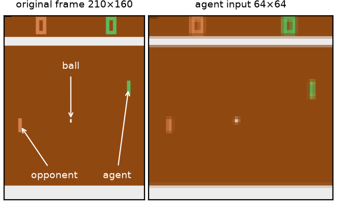
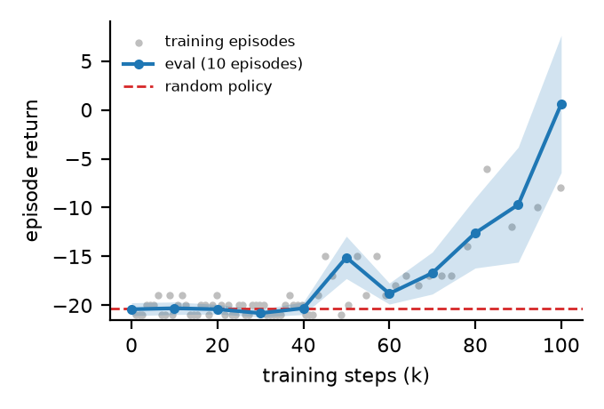
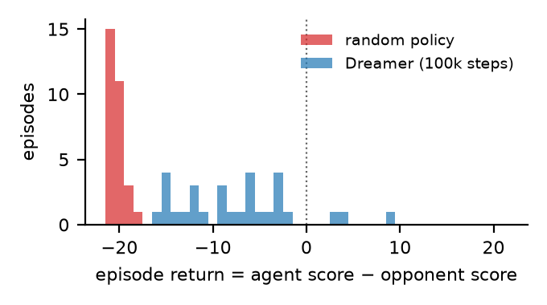
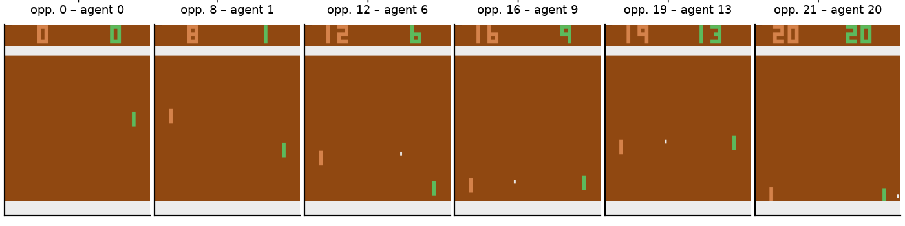
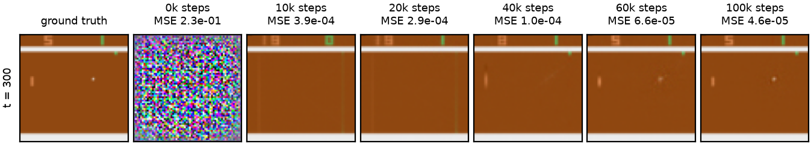
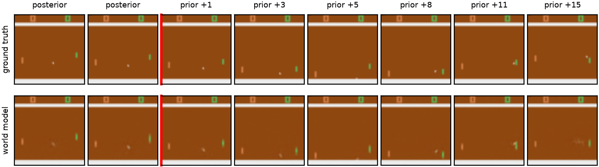

# Tìm hiểu và triển khai thuật toán Dreamer trong Reinforcement Learning

Học phần IT3190 · Nhóm 25 · Bùi Công Hào, MSSV 202400042

Báo cáo tiến độ: [`report/Group25_ProgressReport.pdf`](report/Group25_ProgressReport.pdf)

## Bài toán

Huấn luyện một agent tự học chơi Pong trên Atari 2600 chỉ từ ảnh màn hình. Agent điều khiển vợt bên phải, nhận reward
+1 khi ghi bàn và −1 khi để opponent ghi bàn; episode kết thúc khi một bên đạt 21 bàn. Số step tương tác với môi trường
bị giới hạn ở 100 nghìn theo chuẩn Atari 100k.

<p align="center"></p>

## Phương pháp

Em cài đặt lại DreamerV3 bằng PyTorch. Mỗi lần cập nhật gồm hai giai đoạn:

1. **World model learning**: encoder biến ảnh thành vector, RSSM giữ latent state gồm phần deterministic $h_t$ (GRU) và
   phần stochastic $z_t$ (32 biến categorical, mỗi biến 32 classes). Decoder tái tạo ảnh, reward predictor và continue
   predictor được học cùng KL divergence giữa posterior và prior.
2. **Actor-critic learning trong imagination**: từ mỗi latent state của dữ liệu thật, actor sinh imagined trajectory dài
   15 steps bằng world model; critic học ước lượng λ-return, actor học bằng REINFORCE với return normalization và entropy
   regularization. Gradient của actor và critic không truyền vào world model.

## Kết quả

Pong, 100.000 training steps (400.000 frames), 24.750 gradient updates, model 17,9M parameters, 1 GPU NVIDIA L4, 2,5 giờ.

| Agent | Mean return (30 episodes) | Min / Max | Wins |
|---|---|---|---|
| Random policy | −20,33 ± 0,79 | −21 / −18 | 0 / 30 |
| Dreamer | −7,43 ± 6,06 | −16 / 9 | 3 / 30 |

Dreamer được huấn luyện một lần với seed 0; độ lệch chuẩn tính trên các episode của final evaluation.

<p align="center"> </p>

Một episode của agent sau khi huấn luyện:

<p align="center"></p>

Output của decoder tại các checkpoint và khả năng dự đoán của world model khi không được nhìn ảnh:

<p align="center"></p>
<p align="center"></p>

## Cấu trúc thư mục

```text
dreamer/    config, môi trường Atari, replay buffer, networks (encoder, RSSM, decoder), agent, evaluation
scripts/    train, evaluate, random baseline, tạo hình và bảng cho báo cáo
tests/      unit test và kiểm tra thuật toán trên một môi trường đơn giản
results/    kết quả, log của lần huấn luyện và các hình trong báo cáo
report/     mã nguồn Typst và file PDF của báo cáo
```

## Cài đặt

```bash
python -m venv .venv && source .venv/bin/activate
pip install -r requirements.txt
python -m tests.test_core
```

## Huấn luyện và đánh giá

```bash
# Huấn luyện; chạy lại cùng lệnh với cùng --logdir để tiếp tục từ checkpoint
python -m scripts.train --logdir runs/p1_pong_s0 --steps 100000 --seed 0

# Random baseline và final evaluation (30 episodes)
python -m scripts.random_baseline --episodes 30 --seed 123 --out results/p0_random.json
python -m scripts.eval --ckpt runs/p1_pong_s0/ckpt/model_0100000.pt --episodes 30 --seed 123 --out results/p3_final.json
```

## Tạo lại hình và báo cáo

Các hình learning curve, loss và bảng kết quả được tạo từ log trong `results/`:

```bash
python -m scripts.plot --run results/runs/p1_pong_s0 --out results/figures
python -m scripts.make_tables --run results/runs/p1_pong_s0
python -m scripts.model_size --run results/runs/p1_pong_s0
python -m scripts.pong_figure --out results/figures
```

Các hình cần checkpoint (episode của agent, output của decoder, open-loop prediction) yêu cầu chạy huấn luyện trước.

```bash
python -m scripts.play_figure --ckpt runs/p1_pong_s0/ckpt/model_0100000.pt --seed 2024 --out results/figures
python -m scripts.visualize --ckpt runs/p1_pong_s0/ckpt/model_0100000.pt --out results/figures
python -m scripts.recon_figure --ckpts runs/p1_pong_s0/ckpt/model_0000000.pt runs/p1_pong_s0/ckpt/model_0010000.pt \
    runs/p1_pong_s0/ckpt/model_0020000.pt runs/p1_pong_s0/ckpt/model_0040000.pt \
    runs/p1_pong_s0/ckpt/model_0060000.pt runs/p1_pong_s0/ckpt/model_0100000.pt --out results/figures

typst compile --root . report/main.typ report/Group25_ProgressReport.pdf
```

## Tài liệu tham khảo

- D. Hafner et al., *Dream to Control: Learning Behaviors by Latent Imagination*, ICLR 2020.
- D. Hafner et al., *Mastering Atari with Discrete World Models*, ICLR 2021.
- D. Hafner et al., *Mastering diverse control tasks through world models*, Nature 2025.
- M. G. Bellemare et al., *The Arcade Learning Environment: An Evaluation Platform for General Agents*, JAIR 2013.
- L. Kaiser et al., *Model-Based Reinforcement Learning for Atari*, ICLR 2020.
